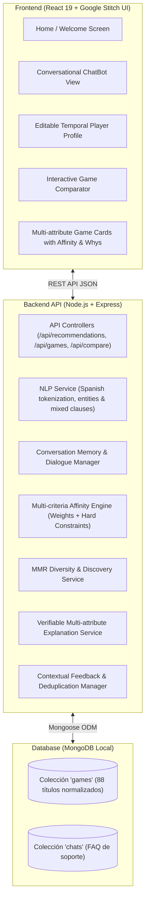

# RecoGames — Asistente Inteligente para la Recomendación Personalizada de Videojuegos (PC)

[](https://nodejs.org/)
[](https://react.dev/)
[](https://expressjs.com/)
[](https://mongoosejs.com/)
[]()
[-purple.svg)]()

> **Proyecto de Investigación Académica:**  
> *“Diseño de un prototipo de asistente inteligente para la recomendación personalizada de videojuegos”*  
> **Repositorio:** [https://github.com/MiguelFuentess/chatbot](https://github.com/MiguelFuentess/chatbot)

---

## 1. Contexto Académico y Evolución del Proyecto

### Pregunta de Investigación
> *“¿Cómo podríamos diseñar un prototipo de asistente inteligente que recomiende videojuegos de forma realmente personalizada, considerando no solo lo que el jugador hace, sino también cómo se siente y qué necesita en ese momento?”*

### Principio de Privacidad y Ética
El asistente **no diagnostica estados psicológicos ni emplea cámaras, micrófonos ni vigilancia biométrica**. La dimensión emocional se fundamenta exclusivamente en la **expresión voluntaria en lenguaje natural** por parte del jugador (ej. *"estoy cansado y busco relajarme"* o *"quiero un reto estimulante"*), tratándola como una preferencia contextual temporal y respetando su autonomía.

### Síntesis de las 8 Etapas de la Tercera Evolución:
1. **Etapa 1 — Ampliación y Normalización de Metadatos:** Esquema Mongoose con 7 atributos dimensionales de experiencia (0 a 5): combate, narrativa, exploración, creatividad, estrategia, libertad y complejidad, además de duración de sesión y estilo de objetivos.
2. **Etapa 2 — Ampliación del Catálogo a 88 Videojuegos:** Catálogo enriquecido de 88 títulos reales para PC con carátulas HTTPS verificadas, modalidades de juego y descripciones precisas.
3. **Etapa 3 — Filtros Avanzados y Afinidad Multicriterio:** Motor de afinidad basado en coincidencia semántica, distancia euclidiana de experiencia, prelación de restricciones duras (*hard constraints*) y ponderación normalizada.
4. **Etapa 4 — Diversidad y Descubrimiento (MMR):** Selección balanceada de recomendaciones mediante *Maximal Marginal Relevance* para evitar burbujas de recomendación, soportando modos Familiar ($\lambda = 0.85$) y Exploratorio ($\lambda = 0.50$).
5. **Etapa 5 — Perfil Temporal Editable del Jugador:** Panel visual interactivo que permite inspeccionar las preferencias deducidas por el sistema y editarlas directamente con sincronización bidireccional reactiva.
6. **Etapa 6 — Comparador Visual y Conversacional:** Módulo analítico para contrastar dos títulos en sus dimensiones de experiencia, dificultad, ritmo y estimación de afinidad.
7. **Etapa 7 — Retroalimentación Inteligente y Deduplicación:** Procesamiento de rechazos contextuales (*"demasiado difícil"*, *"muy violento"*), preguntas de seguimiento adaptativas y deduplicación de eventos en memoria.
8. **Etapa 8 — Validación Integral y Evaluación de Calidad:** Batería de auditoría integral con 19 suites de prueba (330 tests automatizados, 100% aprobados), cálculo de 8 métricas de calidad e instrumentos metodológicos para validación empírica con usuarios reales.

---

## 2. Arquitectura del Sistema

El sistema implementa una arquitectura **MERN en capas modulares**:



---

## 3. Modelo Matemático y Algoritmos

### 3.1. Puntuación de Afinidad Multicriterio ($Score$)
Para cada videojuego $g$ y perfil de criterios acumulado $P$:

$$\text{Score}(g, P) = \left( \sum_{c \in C_{\text{activos}}} w_c' \cdot S_c(g, P) \right) + \text{Bonus}_{\text{similar}} - \text{Penalización}_{\text{feedback}}$$

Donde $w_c' = \frac{w_c}{\sum_{k \in C_{\text{activos}}} w_k}$ normaliza dinámicamente los pesos entre los criterios mencionados.

### 3.2. Selección Diversa con MMR (Maximal Marginal Relevance)
Para balancear afinidad y diversidad en un lote de recomendaciones $R$:

$$\text{MMR}(g) = \lambda \cdot \text{Afinidad}(g, P) - (1 - \lambda) \cdot \max_{r \in R} \text{Similitud}(g, r)$$

- $\lambda = 0.85$: Modo Familiar / Alta coincidencia.
- $\lambda = 0.50$: Modo Descubrimiento / Exploratorio.

---

## 4. Estructura del Repositorio

```
chatbot videojuegos/
├── README.md                       # Documentación integral y académica del proyecto
├── backend/
│   ├── server.js                   # Punto de entrada de la API Express (puerto 5000)
│   ├── package.json                # Dependencias y scripts de prueba
│   ├── models/
│   │   ├── Game.js                 # Esquema de 88 videojuegos con atributos de experiencia
│   │   └── chat.js                 # Esquema de preguntas y respuestas FAQ
│   ├── services/
│   │   ├── nlpService.js           # Extracción semántica y cláusulas adversativas
│   │   ├── recommendationEngine.js # Algoritmo multicriterio determinista
│   │   ├── diversityService.js     # Selección diversa MMR y modos de descubrimiento
│   │   ├── explanationService.js   # Explicabilidad verosímil y transparente
│   │   ├── conversationMemoryService.js # Memoria habitual vs necesidades de sesión
│   │   ├── dialogueManager.js      # Gestión de estados conversacionales y turnos
│   │   ├── questionSelector.js     # Preguntas adaptativas orientadas a entropía
│   │   ├── comparisonService.js    # Comparación dimensional de videojuegos
│   │   └── feedbackManager.js      # Gestión de retroalimentación y deduplicación
│   ├── controllers/                # Controladores HTTP de recomendación, catálogo y comparación
│   ├── routes/                     # Rutas REST de la API
│   ├── data/
│   │   ├── seedGames.json          # Dataset normalizado con 88 videojuegos de PC
│   │   └── seedRunner.js           # Script de migración y población de MongoDB
│   └── test/                       # 19 suites de pruebas automatizadas
└── frontend/
    ├── package.json                # Scripts y dependencias React 19
    ├── src/
    │   ├── App.js                  # Enrutador principal de vistas
    │   ├── Pages/                  # Vistas Home y ChatBot
    │   └── components/             # ChatBot, GameCard, QuickReplies, PlayerProfile, GameComparator
```

---

## 5. Instrucciones de Instalación y Ejecución

### Prerrequisitos
- **Node.js** (v18 o superior; verificado en v24.11.1).
- **MongoDB** (Servicio local en ejecución en el puerto `27017`).

---

### Paso 1: Configurar y Levantar el Backend

1. Abre una terminal en la carpeta `backend`:
   ```bash
   cd backend
   npm install
   ```
2. Poblar la base de datos con el catálogo de 88 videojuegos:
   ```bash
   npm run seed
   ```
3. Ejecutar las suites de pruebas automatizadas (330 tests):
   ```bash
   npm test
   ```
4. Iniciar el servidor API en el puerto 5000:
   ```bash
   npm start
   ```

---

### Paso 2: Configurar y Levantar el Frontend

1. Abre una segunda terminal en la carpeta `frontend`:
   ```bash
   cd frontend
   npm install
   ```
2. Compilar el proyecto para producción o iniciar servidor de desarrollo:
   ```bash
   npm start
   ```
   *(La interfaz se abrirá en tu navegador en `http://localhost:3000`).*

---

## 6. Resultados de Validación y Métricas de Calidad (Etapa 8)

| Métrica Formal Auditada | Valor Obtenido | Criterio de Calidad | Estado |
|---|:---:|:---:|:---:|
| **Cumplimiento de Restricciones Estrictas** | **100.00%** | $\ge 98\%$ | Óptimo |
| **Cobertura del Catálogo en Pruebas** | **39.77%** (35/88 títulos) | Cobertura amplia | Conforme |
| **Diversidad Intra-Tanda (Distancia MMR)** | **56.86%** | Balance afinidad/variedad | Óptimo |
| **Tasa de Repetición al Pedir Alternativas** | **0.00%** (0 títulos repetidos) | $\le 5\%$ | Óptimo |
| **Consistencia de Memoria Conversacional** | **100.00%** | $\ge 95\%$ | Óptimo |
| **Validez Factual de Explicaciones** | **100.00%** | 100% verosímil | Óptimo |
| **Estabilidad Técnica Global** | **330 / 330 Pruebas** (100%) | 100% pasando | Óptimo |
| **Latencia Mediana P50 del Motor** | **9.9 ms** | $< 100\text{ ms}$ | Óptimo |
| **Latencia Percentil 95 (P95)** | **86.9 ms** | $< 400\text{ ms}$ | Óptimo |
